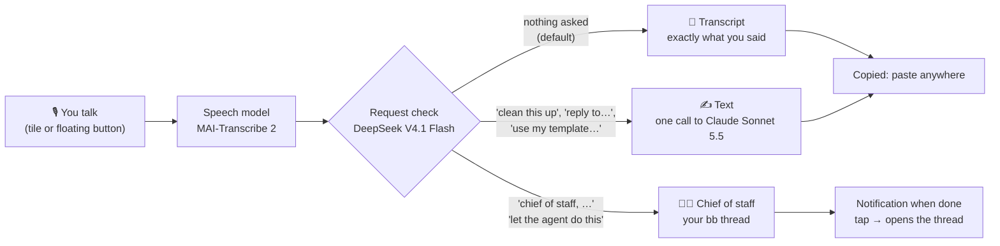
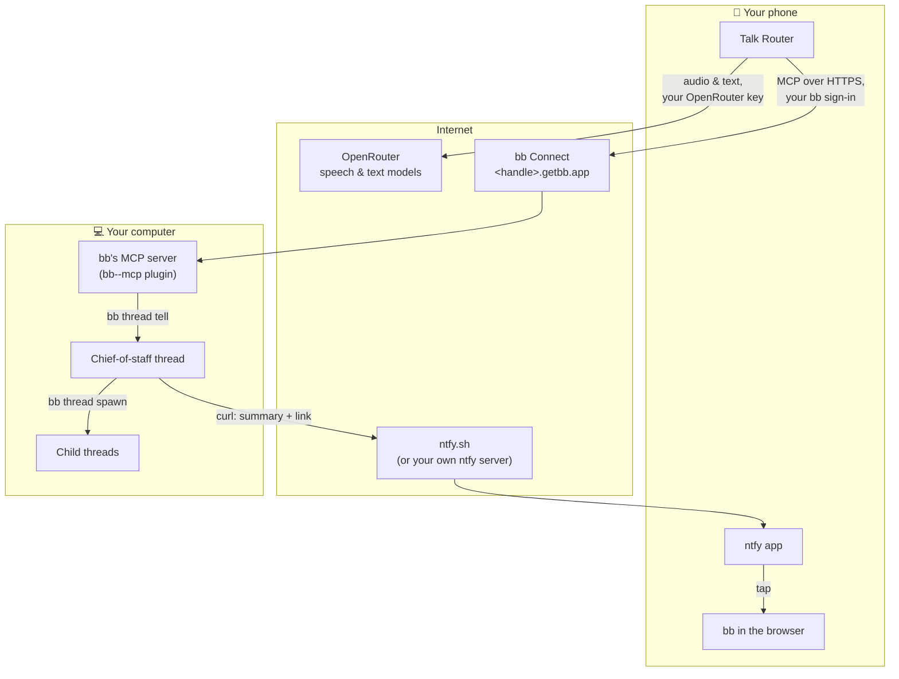
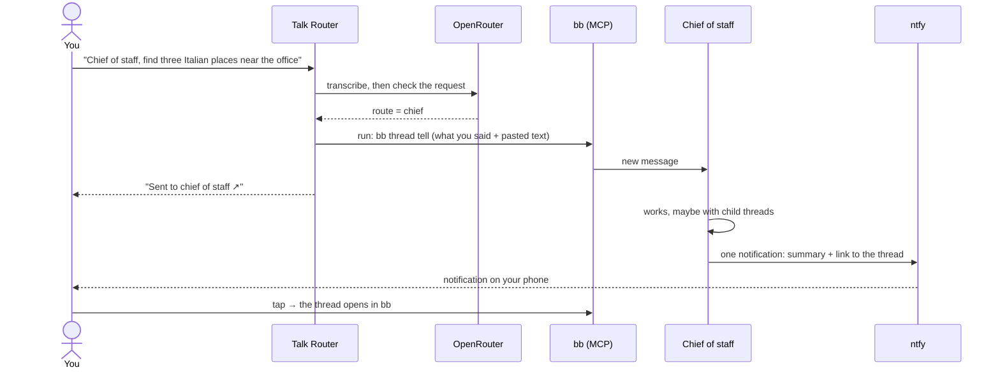
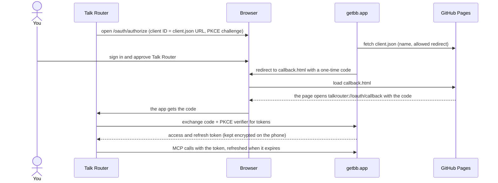

# Talk Router

**Start anything by voice, from anywhere on your phone.** Tap, talk, stop. Talk Router works out what you meant:

- you just wanted it **written down**,
- you wanted a **text** made from it,
- or you wanted your **agent** to take care of it.

  
  
  

## The idea

You already talk to agents all day: in chat apps, IDEs, terminals. Each has its own window and its own microphone button. Talk Router is the one place in front of all of them:

- **It's always there.** A Quick Settings tile and a floating button work over any app. You keep reading, scrolling or switching apps while you talk; silence never ends a recording.
- **It decides where your words go.** A fast model reads every dictation and picks one of three routes. You steer it just by how you talk.
- **It hands tasks off instead of doing them itself.** Real work happens in your agent ([bb](https://getbb.app), running on your own computer), where the thread is saved, visible and can continue later. Talk Router is only the entry point.

### Values

1. **Talk anywhere.** Start with your voice from any app.
2. **Say it once, get it right.** The best speech and text models, so the text is right the first time.
3. **One entry point.** Text right away, or handed to your agent.
4. **Yours.** Open source, your own keys, no server in between.

## The three routes

| Route | When | What you get |
|---|---|---|
| **Transcript** | You didn't ask for anything. This is the default. | Exactly what you said, copied, ready to paste. |
| **Text** | You asked for a text: "make this more formal", "reply to this offer", "turn it into bullet points", "use my apartment application, but for…" | One model call writes it. Copied, ready to paste. What you said stays one tap away. |
| **Chief of staff** | You addressed your agent: "chief of staff, find me…", "tell my chief of staff…", "let the agent do this…" | The task goes to your chief-of-staff thread in bb. You get a notification when it's done, and the thread holds the result. |

**Tip:** say where it goes at the start: "Chief of staff, …". Without a clear address, Talk Router plays it safe and gives you a transcript.

Templates (texts you reuse) and 📎 context (something you copied, an image, a PDF) go along with the text route. For the chief of staff, pasted text goes along; files don't yet.

## How it fits together

There is no Talk Router server. The phone talks directly to three services, each with your own account:

- **OpenRouter:** speech, the request check and the text call. You pay OpenRouter directly for what you use; every note shows what it cost, and Settings → Activity shows which model did what, how long it took and what it cost.
- **bb:** an agentic IDE that runs coding agents (Claude Code, Codex, …) on your own computer. Talk Router uses bb's built-in MCP server and its `run` tool to create the chief-of-staff thread (`bb thread spawn`) and to send it your dictations (`bb thread tell`). The chief does small things itself and hands bigger work to child threads.
- **ntfy:** a simple notification service. The chief sends exactly one notification per request, with a summary it writes itself and a link to its thread. The topic is a long random name that only you know. Talk Router itself sends no notifications.

### What happens when you hand off a task

If bb can't be reached, the note keeps what you said, says why, and offers **Send again**.

### Signing in to bb

Talk Router reaches your bb through bb Connect (`https://<handle>.getbb.app/mcp`), with OAuth 2.1 and PKCE: no password or secret ever goes into the app. bb has no app registration; instead, an app's ID is the address of a small public JSON file describing it. Talk Router's lives on this repo's GitHub Pages ([client.json](https://philipp258.github.io/talk-router/oauth/client.json)).

The redirect goes through a page on GitHub Pages because bb only accepts an `https` address next to the client file. The code is useless without the verifier, which never leaves the phone.

Instead of bb Connect you can also enter any address of bb's MCP server yourself, e.g. one on your tailnet (Tailscale Serve), with an optional token.

## Setup

**You need:**
- An Android phone, Android 14 or newer.
- An [OpenRouter](https://openrouter.ai) account with a key and a few dollars of credits. A one-minute note usually costs well under one cent.
- For the agent route (optional): [bb](https://getbb.app) on your computer, signed in to your bb account with bb Connect on, plus the [ntfy](https://ntfy.sh) app on your phone (Google Play or F-Droid).

**Steps:**
1. **Install** the APK from the [latest release](https://github.com/Philipp258/talk-router/releases/latest), or build it yourself ([Build & test](docs/DEVELOPMENT.md)).
2. **Open Talk Router.** Setup asks for your OpenRouter key and checks it, asks for the microphone, and shows how to start, stop and paste from any app (tile and floating button).
3. **Connect bb** (or tap *Later*):
   1. On your computer, turn on bb's MCP server once: `bb plugin enable bb--mcp`.
   2. In Talk Router, enter your bb Connect handle (the `<handle>` in `<handle>.getbb.app`) and tap **Sign in with bb**. Approve Talk Router on the bb page.
4. **Chief of staff:** tap **Create**. Talk Router starts a thread called "Chief of staff" in your Personal project in bb, with standing instructions. You can also pick an existing thread.
5. **Notifications:** tap **Open in ntfy** to subscribe to your topic in the ntfy app, then **Send test**.
6. **Try it:** "Chief of staff, find three Italian places near the office and send me a short list."

Everything can be changed later in Settings: the key, the speech model, words Talk Router should know, templates, bb and notifications.

## Privacy

- Notes and audio stay on the phone, encrypted. There's no Talk Router account and no server.
- When you dictate, audio and text go to OpenRouter and the model provider it uses. When you hand off a task, what you said (and text you pasted) goes to your bb.
- Your chief's notifications pass through ntfy.sh (or your own ntfy server) under your random topic.
- No Accessibility access, no screen reading.

Details: [Privacy & storage](docs/PRIVACY.md).

## More

[Using the app](docs/GUIDE.md) · [Build & test](docs/DEVELOPMENT.md) · [Plan and decisions: agents through bb](docs/plans/bb-bridge.md)

Eight languages: English, German, French, Spanish, Italian, Portuguese, Dutch, Polish.

## License

[MIT](LICENSE)
