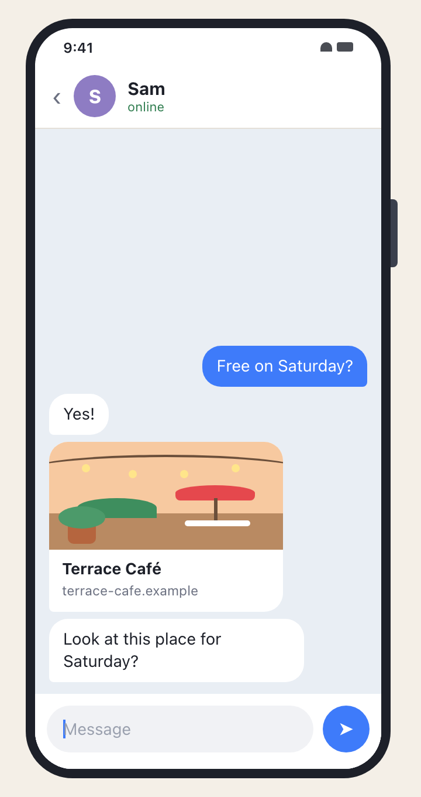
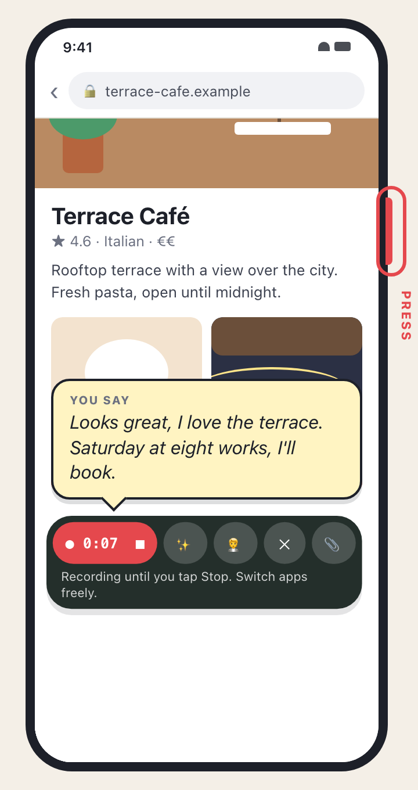
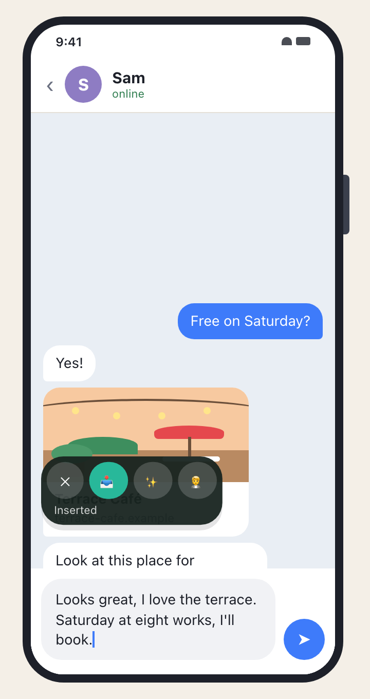
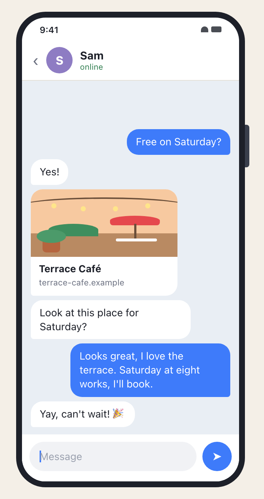
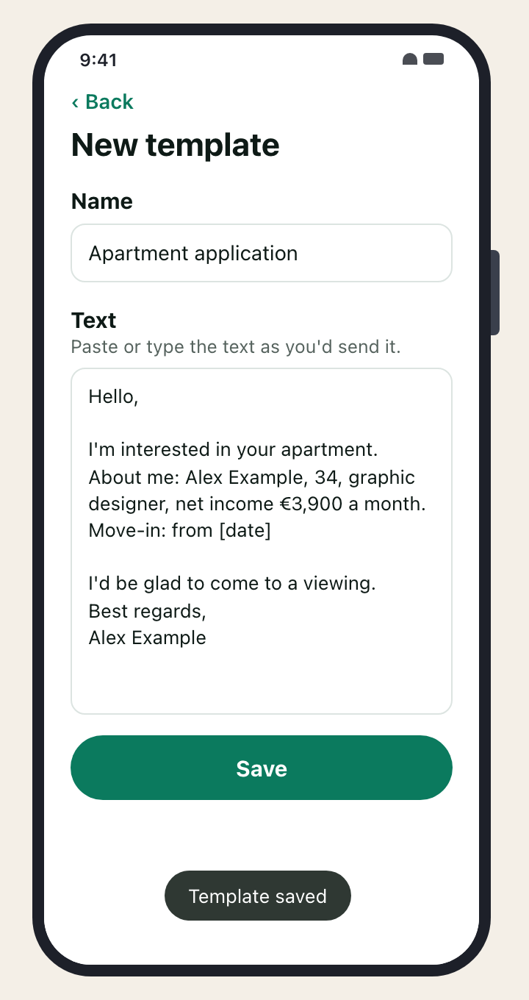
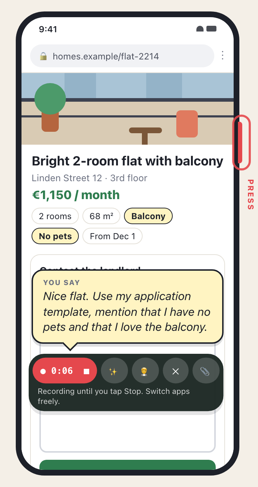
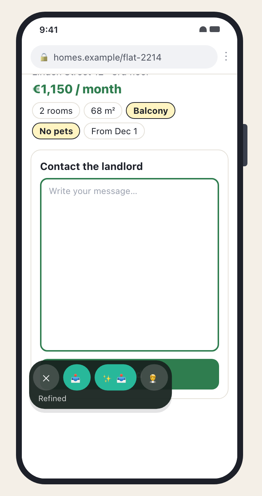
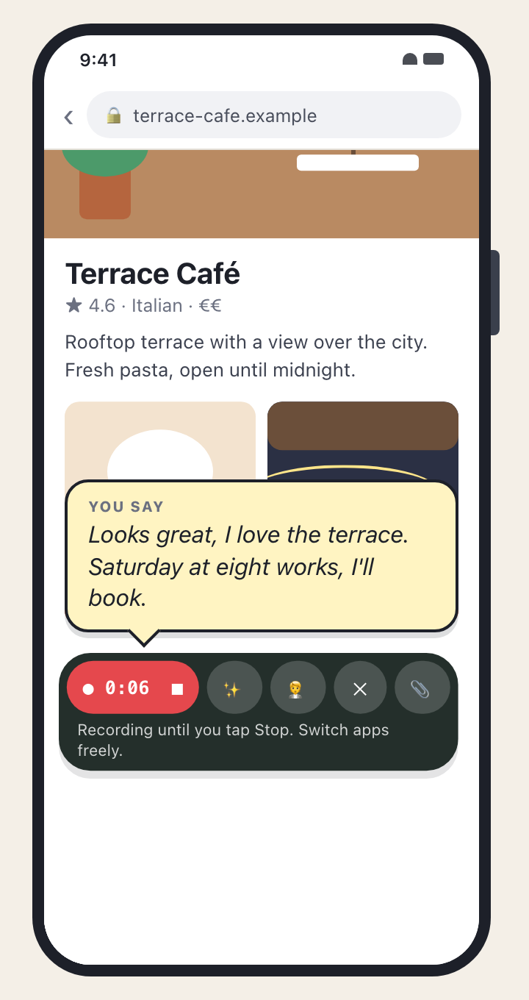

# Talk Router

**One intuitive shortcut to AI, from any app on your phone.**

Press a key and talk: dictation, text creation and independent agents, from one starting point.

<table>
<tr><td colspan="4"><b>Dictate while you browse</b></td></tr>
<tr>
<td width="25%" valign="top"></td>
<td width="25%" valign="top"></td>
<td width="25%" valign="top"></td>
<td width="25%" valign="top"></td>
</tr>
<tr>
<td valign="top">① A friend sends you a place for Saturday.</td>
<td valign="top">② Start talking while you look at it.</td>
<td valign="top">③ Your words appear in the chat.</td>
<td valign="top">④ Send.</td>
</tr>
<tr><td colspan="4"><b>Write from your own template</b></td></tr>
<tr>
<td width="25%" valign="top"></td>
<td width="25%" valign="top"></td>
<td width="25%" valign="top"></td>
<td width="25%" valign="top"></td>
</tr>
<tr>
<td valign="top">① Save your application once as a template.</td>
<td valign="top">② Start talking while you look at the offer: <i>"Use my application template, mention that I have no pets and that I love the balcony."</i></td>
<td valign="top">③ It writes the application from your template.</td>
<td valign="top">④ It lands in the contact form, ready to send.</td>
</tr>
</table>

<b>Hand it to your agent.</b> <i>"Ada, build me a little snake game."</i> Your agent builds it on your computer, and you make it better by talking while you play.

https://github.com/user-attachments/assets/1d1d507f-47d5-4513-99e1-ce83b8d83619

## What it does

### Dictate anywhere

Press a shortcut in any app and talk. A small floating panel stays next to whatever you're doing, so you can keep browsing, reading or testing while you speak. When you're done, you can use the transcript anywhere.

### Refine: one model call, any instruction

**✨ Refine** sends what you said through a single call to a text model. It quickly processes or generates any text you need, based on:

- a default prompt (roughly "find the intention of the text and improve it towards it"),
- predefined text templates (like a sample job application),
- any instruction you dictate ("Write an application to startup X based on our template. Emphasize that…").

### Hand off larger tasks to agents

Talk Router sends your dictation to an agent running on its own machine, your laptop or a server, through [bb](https://getbb.app), with Claude Code or Codex on your existing subscription. Usually you'd have a kind of "coordinator" or "chief of staff" agent there that routes and manages all larger independent work. This can include coding, research, recurring tasks and a lot of other things.

### The best models, pay per use

The latest speech models: MAI-Transcribe 2 by default, 60 languages, and you can switch languages mid-sentence. You pay per use at the providers' prices, about $0.10 per hour of audio, so half an hour of talking a day comes to about $1.50 a month. There's no subscription, and every note shows what it cost.

### Open source, private by design

No Talk Router server, no account, no analytics. You use your own keys, and notes stay encrypted on the phone. It's MIT licensed, so you can read exactly what it sends. [Privacy details](docs/PRIVACY.md)

## Why bb

bb runs Claude Code and Codex and adds nice extra features on top. It works with common subscriptions like Claude and ChatGPT, has full remote control, and gives Talk Router a nice interface to communicate with.

## Install

**You need:** an [OpenRouter](https://openrouter.ai) key and an Android phone with Android 14 or newer. For agents: [bb](https://getbb.app) with Claude Code or Codex, and the free [ntfy](https://ntfy.sh) app for notifications.

1. Download the APK from [Releases](https://github.com/Philipp258/talk-router/releases/latest) and open it on your phone.
2. Open Talk Router and paste your OpenRouter key. Setup walks you through the microphone, the start key and Insert.
3. Optional: in bb, run `bb plugin enable bb--mcp`, then sign in from Talk Router. It sets up your agent.

[How it works](docs/HOW-IT-WORKS.md) · [Using the app](docs/GUIDE.md) · [Build & test](docs/DEVELOPMENT.md) · [Privacy](docs/PRIVACY.md)
