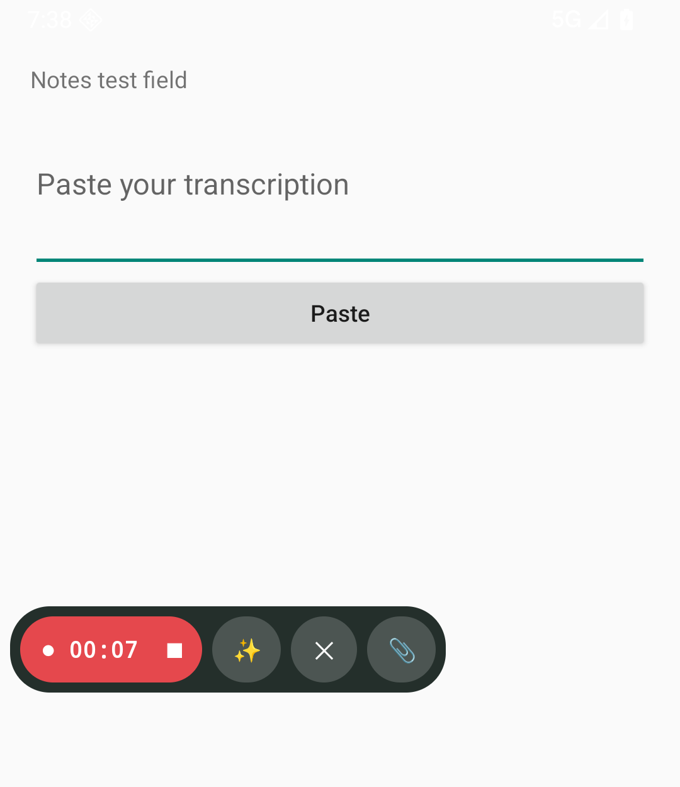
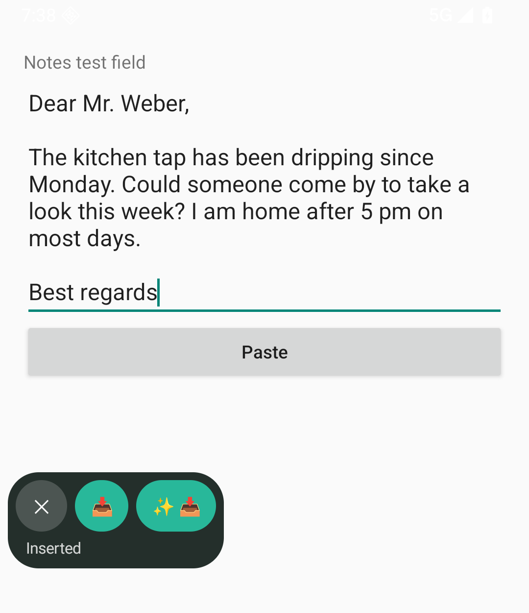
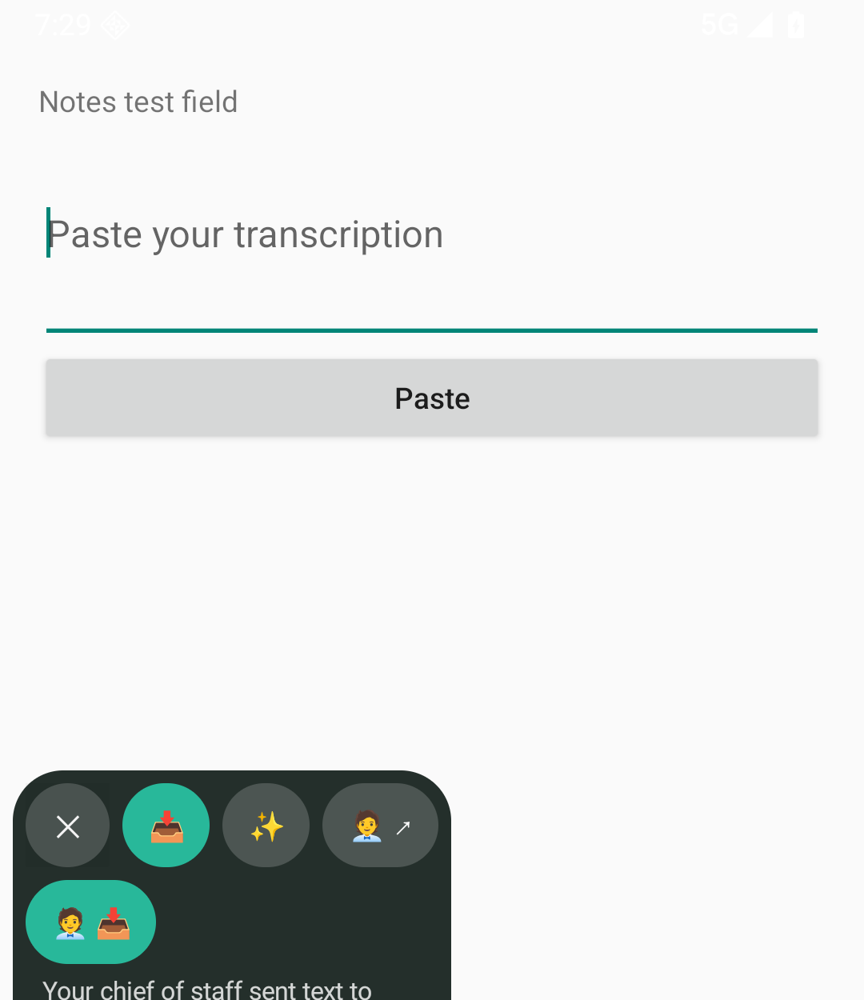
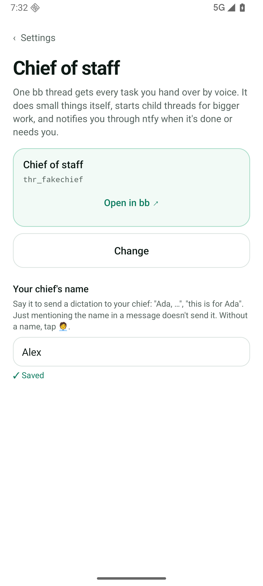
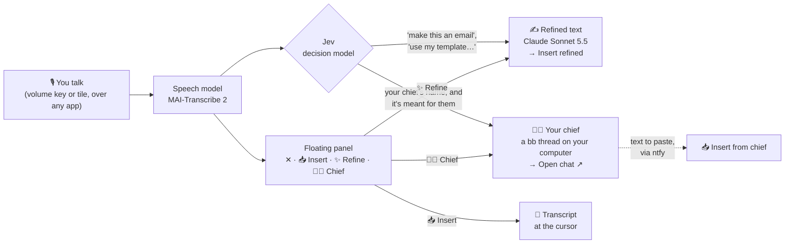
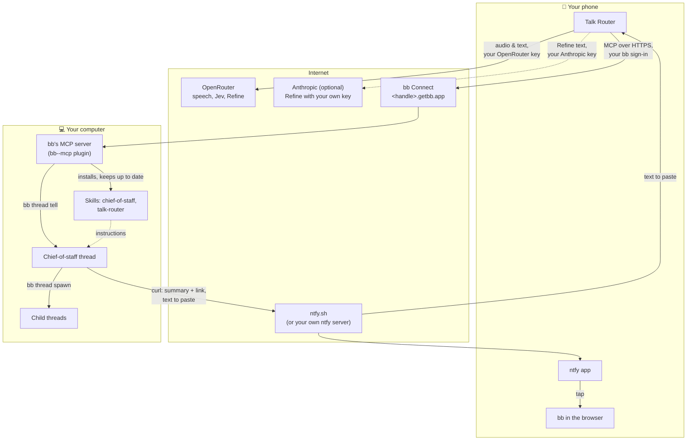
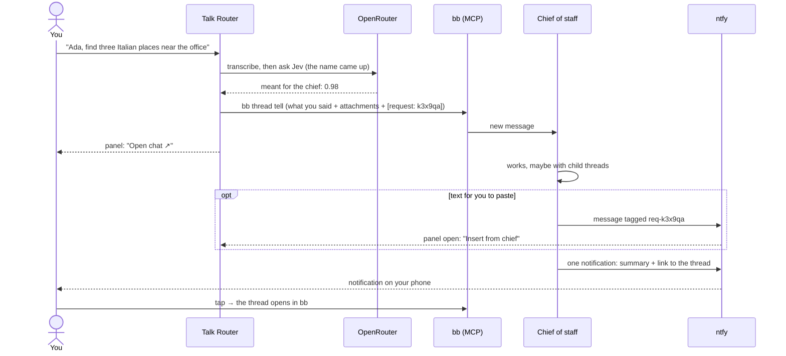
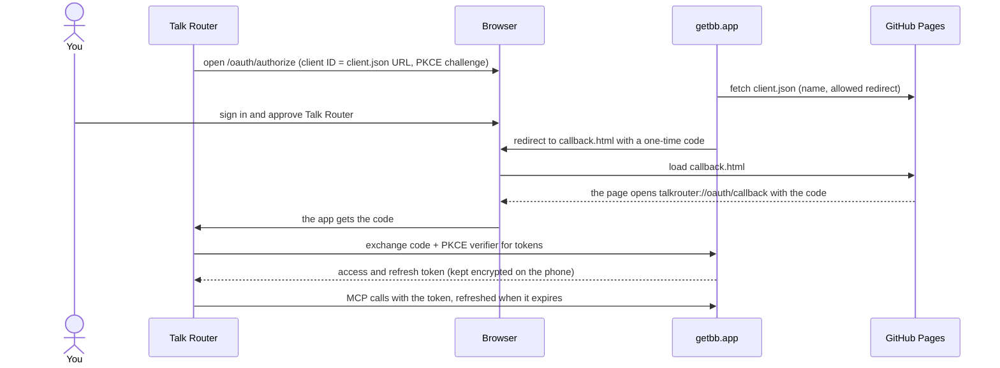

# Talk Router

**Talk instead of type, anywhere on your phone, and hand real tasks to an agent on your own computer.**

Talk Router is an open-source Android app. Hold a volume key (or tap a Quick Settings tile) over any app, talk, stop. A small floating panel appears next to what you were doing, and you choose where your words go:

- 📥 **Insert** them at the cursor, in whatever app you're typing in.
- ✨ **Refine** them first: the message, email or reply you meant, then insert that.
- 🧑‍💼 **Hand them to your chief of staff**, an agent running in [bb](https://getbb.app) on your computer, which does the work and pings you when it's done.

No Talk Router account, no Talk Router server. Your own keys, MIT licensed.

  
  
  

## Why

Typing on a phone is slow, and most of what you type, you could just say. But built-in dictation writes down every "um" and gives up when you pause, and voice assistants only do what they were built for.

Talk Router does three things:

- **It works everywhere.** Hold a volume key over any app and start talking. Keep scrolling, reading or switching apps while you talk; silence never cuts you off. Your words land where your cursor is.
- **You say it once, and it comes out right.** A top speech model (MAI-Transcribe 2) writes down what you said, in whatever language you speak. Ask for "a short email", "more polite" or "my apartment application for this flat", and Claude turns your rambling into that text.
- **It hands off real work.** "Ada, find three Italian places near the office and send me a short list." That goes to *your* agent, a bb thread on your own computer with your tools, files and accounts, not a chatbot in someone's cloud. It works as long as it needs, starts helper threads for bigger jobs, and sends you one notification when it's done, with a link to the thread. If you asked for text to paste, an **Insert from chief** button appears right on the panel.

Talk Router is the entry point, not the agent. It doesn't try to do the work itself; it gets your words to the right place fast.

## What it does

| | |
|---|---|
| **Start anywhere** | Hold volume down or up (Accessibility), tap the Quick Settings tile, or use the button in the app. A short press still changes the volume. |
| **Floating panel** | Appears over any app, never takes focus, and can be dragged anywhere. While you record: ■ stop, ✨ Refine, 🧑‍💼 Chief, ✕ cancel, 📎 attach. Tap ✨ or 🧑‍💼 while still talking, and it runs as soon as the transcript is ready. |
| **📥 Insert** | Puts the text at the cursor of the app you're in. Talk Router never puts anything on your clipboard by itself; only if Insert can't reach a field does it copy instead, and the panel tells you. |
| **✨ Refine** | One call to Claude Sonnet 5.5 works out what the text is for (message, email, note, reply), follows what you asked, fills in a template you named, and keeps your language and facts. **Insert refined** then replaces the raw transcript in place, if you haven't changed it. Runs through OpenRouter, or through Anthropic directly with your own Anthropic key. |
| **Templates** | Texts you write again and again (an application, a standard reply). Say "use my apartment application for…" and Refine fills it in. |
| **📎 Attach** | Talking about something, like a listing you're replying to? While you record, add what you copied, an image or a PDF. Refine reads it, and the chief gets it too. |
| **🧑‍💼 Chief of staff** | Sends what you said, plus anything you attached with 📎 (copied text, images, PDFs), to a bb thread on your computer that acts for you: small things itself, bigger work in parallel child threads. It notifies you through [ntfy](https://ntfy.sh) when it's done or needs you. |
| **Say its name** | Give your chief a name, say "Ada, …" or "this is for Ada", and the dictation goes there by itself. "Say hi to Ada" stays with you: a fast decision model (Jev) tells the two apart. |
| **Text back** | When the chief writes something for you to paste, **Insert from chief** appears on the panel (or **Copy** on the notification). |
| **Costs in view** | Every note shows what it cost, usually a fraction of a cent. Activity shows which model did what and how long it took. |
| **Notes** | Every dictation is kept on the phone, encrypted: what you said and the refined version. Redo a note with a more accurate speech model. |

Eight languages in the app: English, German, French, Spanish, Italian, Portuguese, Dutch, Polish. The speech model understands many more, and you can switch languages mid-sentence.

  
  
  

## How it works

### One start, three ways on

After the transcript, Jev (about 0.3 s and $0.00003) answers a few questions: did you ask for a text or name a template? Then Refine starts by itself. Did your chief's name come up, and is the dictation meant for them? Then it goes to the chief by itself, as you said it. If Jev isn't sure, 🧑‍💼 is only highlighted; if Jev fails, nothing happens by itself and the buttons still work.

### Who talks to whom

There is no Talk Router server. The phone talks directly to the services you set up, with your own accounts:

- **OpenRouter** runs speech, Jev and Refine. You pay OpenRouter directly for what you use; a one-minute note usually costs well under a cent. With your own **Anthropic** key, Refine goes to Anthropic directly on your Anthropic credits, with OpenRouter as the fallback.
- **bb** is an agentic IDE that runs coding agents (Claude Code, Codex, …) on your own computer. Talk Router uses bb's built-in MCP server to create the chief-of-staff thread and send it your dictations. The chief's instructions are two bb skills that Talk Router installs and keeps up to date by itself: **chief-of-staff** (how to work for you: small things itself, bigger work split into child threads with context, intent and what done looks like) and **talk-router** (how to read dictations, notify you and send text back).
- **ntfy** carries the chief's notification (one per request, with a summary and a link to the thread) and text meant for you to paste. Your topic is a long random name only you know. Talk Router itself sends no notifications.

### Handing off a task

If bb can't be reached, the note keeps what you said, says why, and offers **Send again**.

### Signing in to bb

Talk Router reaches your bb through bb Connect (`https://<handle>.getbb.app/mcp`) with OAuth 2.1 and PKCE: no password or secret goes into the app. bb has no app registration; an app's ID is the address of a small public JSON file describing it. Talk Router's lives on this repo's GitHub Pages ([client.json](https://philipp258.github.io/talk-router/oauth/client.json)).

The redirect goes through a page on GitHub Pages because bb only accepts an `https` address next to the client file. The code is useless without the verifier, which never leaves the phone. Instead of bb Connect you can enter any address of bb's MCP server yourself, for example one on your tailnet, with an optional token.

## Setup

**You need:**
- An Android phone with Android 14 or newer.
- An [OpenRouter](https://openrouter.ai) account with a key and a few dollars of credits.
- For the agent (optional): [bb](https://getbb.app) on your computer, signed in with bb Connect on, and the [ntfy](https://ntfy.sh) app on your phone (Google Play or F-Droid).

**Steps:**
1. **Install** the APK from the [latest release](https://github.com/Philipp258/talk-router/releases/latest), or build it yourself ([Build & test](docs/DEVELOPMENT.md)).
2. **Open Talk Router.** Setup asks for your OpenRouter key and checks it, asks for the microphone, and sets up how you start (volume key or tile) and the floating panel. Insert and the volume key need Android's Accessibility permission; setup explains exactly what it's used for. Then you try it once in a practice field.
3. **Connect bb** (or tap *Later*; without bb, Talk Router is a dictation app):
   1. On your computer, turn on bb's MCP server once: `bb plugin enable bb--mcp`.
   2. In Talk Router, enter your bb Connect handle (the `<handle>` in `<handle>.getbb.app`), tap **Sign in with bb** and approve Talk Router on the bb page.
4. **Chief of staff:** tap **Create**. Talk Router installs the two skills in bb, then starts a "Chief of staff" thread that uses them. You can also pick a thread you already have.
5. **Notifications:** tap **Open in ntfy** to subscribe to your topic, then **Send test**.
6. **Name your chief** in Settings, for example "Ada".
7. **Try it:** "Ada, find three Italian places near the office and send me a short list."

Everything can be changed later in Settings. Optional: your own Anthropic key for Refine, templates, words Talk Router should know, and a different speech model. More in [Using the app](docs/GUIDE.md).

## Privacy

Talk Router has no server, no account, no analytics and no crash reporting. What leaves your phone goes straight to the provider you chose:

| What | Goes to | When |
|---|---|---|
| Audio | OpenRouter and the speech model's provider | After you stop recording |
| Transcript, your template names, your chief's name if it came up | OpenRouter → Jev (TypeSafe) | After every transcript |
| Transcript, About you, your words, the template you asked for, attachments | OpenRouter → Anthropic (Claude), or Anthropic directly with your key | Only when Refine runs |
| What you said, pasted text, attached images and PDFs | Your bb, through bb Connect or your own address | Only when it goes to your chief |
| The chief's notifications and text to paste | ntfy.sh (or your own server), under your random topic | When the chief sends them, from your computer |

- **On the phone:** notes, templates and keys are encrypted; audio is kept 7 days for redos (you can turn that off). Backups and device transfer are excluded.
- **Accessibility** is used only for Insert and the volume key. Talk Router asks for no accessibility events and never reads the screen; it looks up the text field you're typing in only when you tap Insert.
- **Clipboard:** written only when you tap Copy, or when Insert can't reach a field. Never by itself.
- **Your agent** runs on your computer, with the model providers you chose in bb.

Details: [Privacy & storage](docs/PRIVACY.md).

## Open source

Talk Router is MIT licensed, and the whole app is in this repo: plain Java, no third-party runtime libraries, no analytics SDKs. Build it yourself, read what it sends, or change it. Issues and pull requests are welcome.

[Using the app](docs/GUIDE.md) · [Build & test](docs/DEVELOPMENT.md) · [Privacy & storage](docs/PRIVACY.md) · [Release notes](docs/releases/3.0.0.md) · Design notes: [agents through bb](docs/plans/bb-bridge.md), [the floating panel](docs/plans/floating-panel.md)

## License

[MIT](LICENSE)
