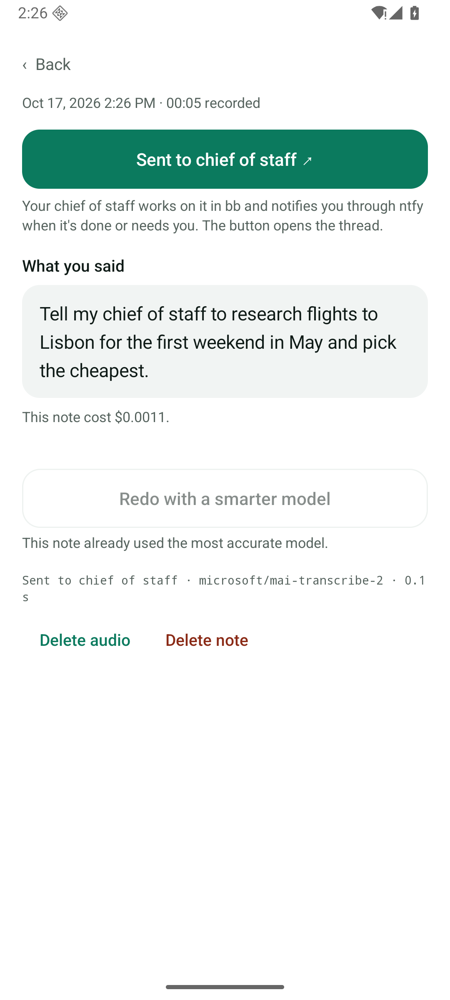
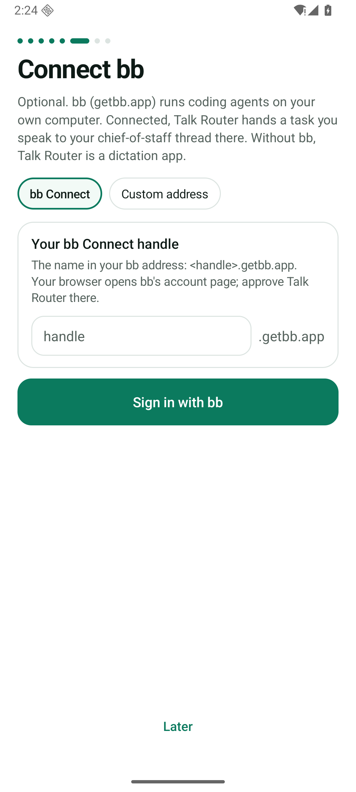
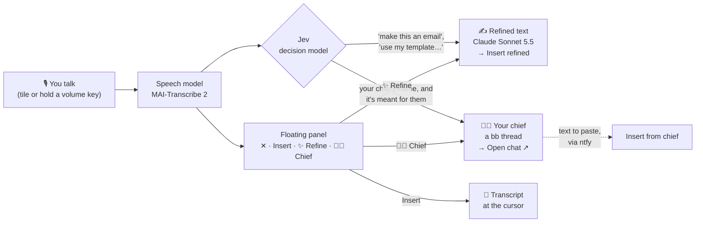
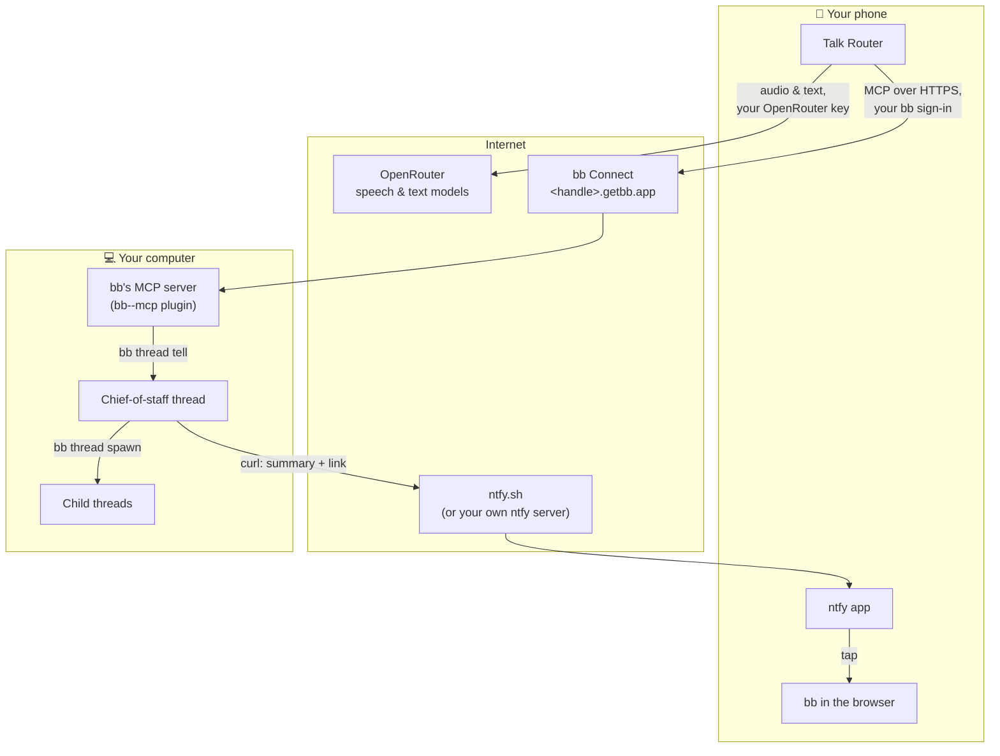
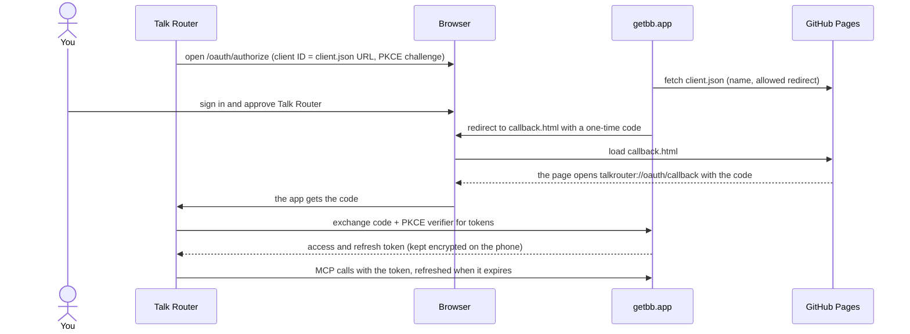

# Talk Router

**Start anything by voice, from anywhere on your phone.** Tap the tile or hold a volume key, talk, stop. Your words come first, and a small floating panel lets you decide what happens with them:

- **Insert** them where you're typing,
- **✨ Refine** them into the text you need,
- or hand them to your **🧑‍💼 chief**, an agent that takes care of it.

  
  
  

## The idea

You already talk to agents all day: in chat apps, IDEs, terminals. Each has its own window and its own microphone button. Talk Router is the one place in front of all of them:

- **It's always there.** A Quick Settings tile, or holding a volume key, starts it over any app. You keep reading, scrolling or switching apps while you talk; silence never ends a recording.
- **You decide where your words go.** The floating panel offers Insert, Refine and Chief, even while you're still talking. A fast decision model starts Refine by itself when you ask for a text, and sends to your chief by itself only when you say it's for them, by name.
- **It hands tasks off instead of doing them itself.** Real work happens in your agent ([bb](https://getbb.app), running on your own computer), where the thread is saved, visible and can continue later. Talk Router is only the entry point.

### Values

1. **Talk anywhere.** Start with your voice from any app.
2. **Say it once, get it right.** The best speech and text models, so the text is right the first time.
3. **One entry point.** Text right away, or handed to your agent.
4. **Yours.** Open source, your own keys, no server in between.

## One start, three ways on

| Button | Does | Then turns into |
|---|---|---|
| **Insert** | Puts what you said at the cursor of the app you're in (through Android's Accessibility service). Without that permission, or without a text field, it's copied instead, and the panel says so. Otherwise Talk Router never touches your clipboard. | – |
| **✨ Refine** | One call to Claude Sonnet 5.5 makes the text you need: works out what it's for (message, email, note, reply), follows what you asked, fills in a template you named, keeps your language and facts. | **Insert refined**. If the transcript you inserted is still unchanged in the field, it's replaced in place. |
| **🧑‍💼 Chief** | Sends what you said, plus pasted text, to your chief-of-staff thread in bb. | **Open chat ↗**, which opens the thread. If the chief sends text back for you to paste, **Insert from chief** appears. |
| **✕** | While recording: cancels, nothing is transcribed or sent. Afterwards: closes the panel; the note stays in Talk Router. | – |

The buttons are icons (📥 Insert, ✨ Refine, 🧑‍💼 Chief, ✕), named for TalkBack; a long press shows the name. While you record, the panel is just the timer with ■ and ⋯; ⋯ opens 📎, ✕, Refine and Chief, which you can tap while still recording: they run once the transcript is ready. Drag the panel anywhere; it remembers the spot.

**What happens by itself.** After the transcript, Jev (TypeSafe's decision model, about 0.3 s and $0.00003) answers a few questions:
- Do you ask for a text, or name a template ("turn this into an email", "use my apartment application…")? Then Refine starts by itself.
- Your chief has a name you choose in Settings, for example "Ada". Only when that name comes up does Jev decide whether the dictation is meant for the chief ("Ada, …", "this is for Ada", "I want to talk to Ada about…") or just mentions them ("say hi to Ada"). If it's meant for the chief, it goes there by itself and isn't refined; if Jev isn't sure, 🧑‍💼 is only highlighted.
- If Jev fails, nothing happens by itself; the buttons still work.

Templates (texts you reuse) and 📎 context (something you copied, an image, a PDF) go along with Refine. For the chief, pasted text goes along; files don't yet.

## How it fits together

There is no Talk Router server. The phone talks directly to three services, each with your own account:

- **OpenRouter:** speech, Jev's decision and Refine (with your own Anthropic key, Refine goes to Anthropic directly instead, on your Anthropic credits, with OpenRouter as the fallback). You pay OpenRouter directly for what you use; every note shows what it cost, and Settings → Activity shows which model did what, how long it took and what it cost.
- **bb:** an agentic IDE that runs coding agents (Claude Code, Codex, …) on your own computer. Talk Router uses bb's built-in MCP server and its `run` tool to create the chief-of-staff thread (`bb thread spawn`) and to send it your dictations (`bb thread tell`). The chief does small things itself and hands bigger work to child threads.
- **ntfy:** a simple notification service. The chief sends exactly one notification per request, with a summary it writes itself and a link to its thread. Text meant for you to paste goes as a second message tagged with the request's ID: while the panel is open, Talk Router reads your topic and shows **Insert from chief**; otherwise the notification's **Copy** button hands it to Talk Router. The topic is a long random name that only you know. Talk Router itself sends no notifications.

### What happens when you hand off a task

If bb can't be reached, the note keeps what you said, says why, and offers **Send again**.

### Signing in to bb

Talk Router reaches your bb through bb Connect (`https://<handle>.getbb.app/mcp`), with OAuth 2.1 and PKCE: no password or secret ever goes into the app. bb has no app registration; instead, an app's ID is the address of a small public JSON file describing it. Talk Router's lives on this repo's GitHub Pages ([client.json](https://philipp258.github.io/talk-router/oauth/client.json)).

The redirect goes through a page on GitHub Pages because bb only accepts an `https` address next to the client file. The code is useless without the verifier, which never leaves the phone.

Instead of bb Connect you can also enter any address of bb's MCP server yourself, e.g. one on your tailnet (Tailscale Serve), with an optional token.

## Setup

**You need:**
- An Android phone, Android 14 or newer.
- An [OpenRouter](https://openrouter.ai) account with a key and a few dollars of credits. A one-minute note usually costs well under one cent.
- For the agent route (optional): [bb](https://getbb.app) on your computer, signed in to your bb account with bb Connect on, plus the [ntfy](https://ntfy.sh) app on your phone (Google Play or F-Droid).

**Steps:**
1. **Install** the APK from the [latest release](https://github.com/Philipp258/talk-router/releases/latest), or build it yourself ([Build & test](docs/DEVELOPMENT.md)).
2. **Open Talk Router.** Setup asks for your OpenRouter key and checks it, asks for the microphone, and sets up how you start (the tile, or holding a volume key) and the floating panel. Insert and the volume key need Android's Accessibility permission for Talk Router; setup explains what it's used for.
3. **Connect bb** (or tap *Later*):
   1. On your computer, turn on bb's MCP server once: `bb plugin enable bb--mcp`.
   2. In Talk Router, enter your bb Connect handle (the `<handle>` in `<handle>.getbb.app`) and tap **Sign in with bb**. Approve Talk Router on the bb page.
4. **Chief of staff:** tap **Create**. Talk Router starts a thread called "Chief of staff" in your Personal project in bb, with standing instructions. You can also pick an existing thread.
5. **Notifications:** tap **Open in ntfy** to subscribe to your topic in the ntfy app, then **Send test**.
6. **Name your chief** in Settings → Chief of staff, for example "Ada".
7. **Try it:** "Ada, find three Italian places near the office and send me a short list."

Everything can be changed later in Settings: the key, how you start, the speech model, Refine, words Talk Router should know, templates, bb and notifications.

## Privacy

- Notes and audio stay on the phone, encrypted. There's no Talk Router account and no server.
- When you dictate, audio and text go to OpenRouter and the model providers it uses (speech, Jev, and Claude when you Refine). With your Anthropic key set, Refine's text goes to Anthropic instead. When you hand off a task, what you said (and text you pasted) goes to your bb.
- Your chief's notifications pass through ntfy.sh (or your own ntfy server) under your random topic.
- Accessibility is used only for Insert and the volume key: Talk Router asks for no accessibility events and looks up the text field you're typing in only when you tap Insert. No screen reading.

Details: [Privacy & storage](docs/PRIVACY.md).

## More

[Using the app](docs/GUIDE.md) · [Build & test](docs/DEVELOPMENT.md) · Plans and decisions: [agents through bb](docs/plans/bb-bridge.md), [the floating panel](docs/plans/floating-panel.md)

Eight languages: English, German, French, Spanish, Italian, Portuguese, Dutch, Polish.

## License

[MIT](LICENSE)
