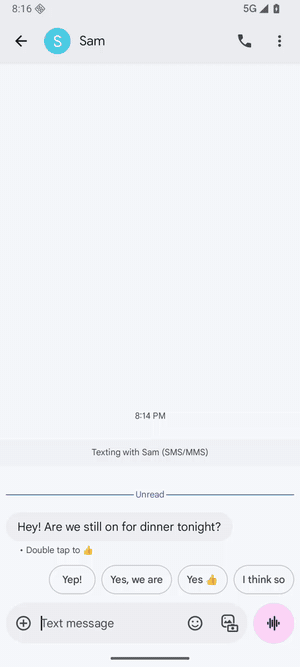
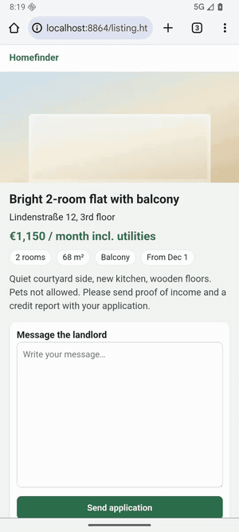
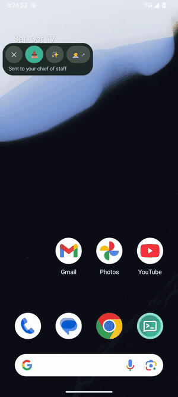

# Talk Router

**Talk instead of type, in any app on your Android phone, and hand real work to an AI agent.**

<table>
<tr>
<td width="33%" valign="top"></td>
<td width="33%" valign="top"></td>
<td width="33%" valign="top"></td>
</tr>
<tr>
<td valign="top"><b>Just say it.</b> Hold a volume key, talk, and your words land in the field you're typing in.</td>
<td valign="top"><b>Say what you want.</b> <i>"Use my standard application, stress that I have no pets."</i> A polished text appears.</td>
<td valign="top"><b>Hand it off.</b> <i>"Ada, every morning at seven, send me a recipe."</i> Your agent takes it from there.</td>
</tr>
</table>

## Why not the phone's built-in dictation? It's free.

- **Much better transcription.** Talk Router uses the latest speech models (MAI-Transcribe 2 by default, which Microsoft reports as #1 on the FLEURS multilingual benchmark). It handles 60 languages, and you can switch languages mid-sentence.
- **Text you'd actually send.** Ramble, then tap ✨ (or just ask for it): Claude (or a model you pick) turns it into the message, email or reply you meant, or fills in one of your templates.
- **Works in any app.** A small floating panel sits next to whatever you're doing. Silence doesn't cut you off.
- **Hands tasks to an agent.** Say your agent's name and the task goes to an AI agent running on your computer, with your files and tools. It researches, writes code, or schedules things to run later, and notifies you when it's done. For now the agent runs in [bb](https://getbb.app); more are planned.
- **No Google needed.** No Google keyboard, no Google account.

## What does it cost, and what do I need?

- **An [OpenRouter](https://openrouter.ai) key.** You pay per use, at the providers' prices: transcription costs **$0.10 per hour of audio**. Half an hour of talking every day comes to about **$1.50 a month**. A refined text costs a fraction of a cent. Subscription dictation apps charge $8–15 a month (Superwhisper Pro $8.49, Wispr Flow Pro $15). Every note shows what it cost.
- **An Android phone** with Android 14 or newer.
- **Optional, for the agent:** [bb](https://getbb.app) on your computer, and the free [ntfy](https://ntfy.sh) app for its notifications.

Prices as of October 2026: MAI-Transcribe 2 at OpenRouter's list price; Superwhisper and Wispr Flow monthly plans.

## Where does my voice go?

Your recording goes through OpenRouter to the speech model. The transcript goes to a small decision model, and to Claude when you refine (through OpenRouter, or straight to Anthropic with your own key). Tasks you hand off go to your own agent. That's all: there's no Talk Router server, and your notes stay encrypted on your phone. [Details](docs/PRIVACY.md)

## How do I install it?

1. Download the APK from [Releases](https://github.com/Philipp258/talk-router/releases/latest) and open it on your phone.
2. Open Talk Router and paste your OpenRouter key. Setup walks you through the microphone, the volume key and Insert.
3. Optional: connect bb to get an agent. In bb on your computer, run `bb plugin enable bb--mcp`, then sign in from Talk Router.

More: [Using the app](docs/GUIDE.md) · [How it works](docs/HOW-IT-WORKS.md)

## Can I trust it?

Talk Router is open source (MIT): read the code, see exactly what it sends, or build it yourself ([Build & test](docs/DEVELOPMENT.md)). There's no server, no account, no analytics, and it only uses your own keys.
