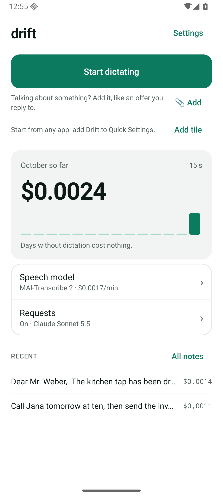
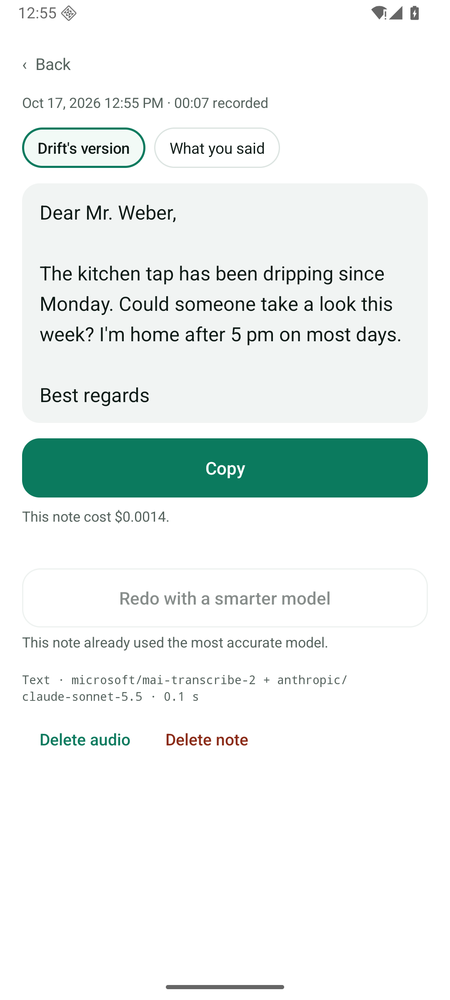
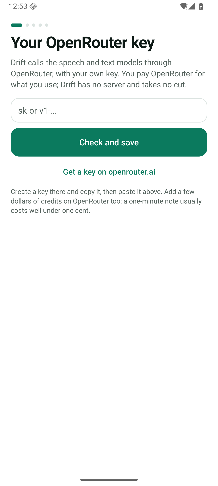

# Talk Router

One place to start anything by voice, on Android. Talk whenever you want; Talk Router decides what you meant:

- **Transcript** (the default): exactly what you said, ready to paste.
- **Text**: when you ask for something ("clean this up", "reply to this offer", "use my apartment application…"), one call to a text model writes it.
- **Your agent**: "tell my chief of staff…" hands the task to your chief-of-staff thread in [bb](https://getbb.app). It works on your own machine and notifies you through [ntfy](https://ntfy.sh) when it's done; the notification opens the thread.

  
  
  

## Values

1. **Talk anywhere.** Start with your voice from any app: Quick Settings tile or floating button. Silence never ends a recording.
2. **Say it once, get it right.** The best speech and text models, so the text is right the first time.
3. **One entry point.** Talk Router decides: the text right away, or handed to your agent.
4. **Yours.** Open source, your own keys, no server in between.

## How it works

- **Your own OpenRouter key.** The phone calls [OpenRouter](https://openrouter.ai) directly. There is no Talk Router server and no account; you pay OpenRouter for what you use, and every note shows what it cost.
- **Models:**
  - Speech: MAI-Transcribe 2 by default, or another model of your choice. Your words are sent as spelling hints.
  - Request check: DeepSeek V4.1 Flash.
  - Text: Claude Sonnet 5.5.
- **Templates and context:**
  - Keep texts you reuse, then say which one and what's different this time.
  - 📎 adds what you copied, an image or a PDF to the dictation.
- **bb (optional):** Talk Router reaches bb's MCP server through bb Connect (sign in with your handle) or an address of your own (tailnet, `adb reverse`), creates the chief-of-staff thread and sends it what you said plus pasted text. Without bb, it's a dictation app.
- **Private by default.** Notes and audio stay encrypted on the phone. Audio and text go only to OpenRouter and its model providers when you dictate, and to your bb when you hand it a task. No Accessibility access, no screen reading, no notifications.
- **Eight languages:** English, German, French, Spanish, Italian, Portuguese, Dutch, Polish.

## Get started

1. Build the APK ([Build & test](docs/DEVELOPMENT.md)). Android 14+.
2. Create a key at [openrouter.ai/keys](https://openrouter.ai/keys) and add a few dollars of credits.
3. Open the app; setup asks for the key and shows how to start, stop and paste. Optionally connect bb, create your chief of staff and subscribe to its ntfy topic.

[Using the app](docs/GUIDE.md) · [Privacy & storage](docs/PRIVACY.md) · [Build & test](docs/DEVELOPMENT.md) · [Plan: agents through bb](docs/plans/bb-bridge.md)

## License

[MIT](LICENSE)
